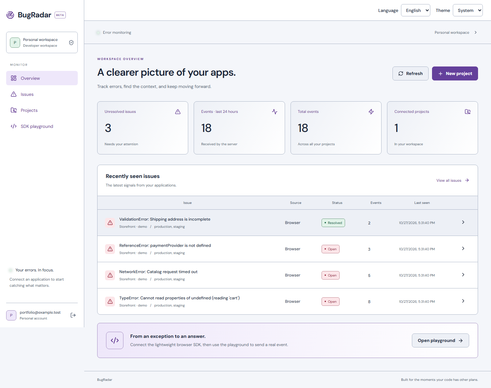

# BugRadar

A full-stack error monitoring project that helps developers capture failures, group repeated events and inspect the context behind an issue. Browser and NestJS SDKs send events to an owner-scoped dashboard.

The product is **BugRadar**. The GitHub repository remains **BugRader** for URL compatibility; workspace packages keep their existing `@bugradar/*` names.



[Arabic mobile view](docs/screenshots/mobile-ar.png) · [Current verification](docs/PORTFOLIO_REVIEW.md) · [Deployment](DEPLOYMENT.md) · [SDK examples and reference](SDK_GUIDE.md)

Screenshots were captured from the running app on 2026-10-27. Counts belong to synthetic seed events, not real users or production traffic. No verified hosted demo is available.

## Implemented features

- Register/login/logout with HttpOnly cookie sessions; each account owns its projects and issues.
- Browser exception/rejection capture, breadcrumbs and a real SDK playground.
- NestJS server exception capture with separate private server ingestion credentials.
- Fingerprint grouping, idempotent retries, event details, search/filter/sort/pagination.
- Open/resolved/ignored issue workflow, activity history and reopening on new events.
- Project origin allowlists, key rotation, payload validation, secret redaction and rate limits.
- Arabic/English and light/dark/system themes with responsive navigation.

## Stack and layout

React, TypeScript, Vite, NestJS, Prisma, PostgreSQL, Vitest. npm workspaces contain `apps/web`, `apps/api`, `apps/nest-demo`, `packages/browser-sdk` and `packages/nestjs-sdk`. SDK packages are local workspaces, not published npm packages.

## Run locally

Requirements: Node 22.12+ (reviewed with Node 24), npm and PostgreSQL 16+.

1. Run `npm ci` at the root.
2. Copy `apps/api/.env.example` to `apps/api/.env` and `apps/web/.env.example` to `apps/web/.env` **only if those files do not already exist**.
3. Create a dedicated database and set `DATABASE_URL`. Alternatively, copy root `.env.example` to `.env`, choose a password, match it in the API URL, and run `docker compose up -d`.
4. Run:

```sh
npm run db:generate
npm run db:setup
npm run build
npm run dev
```

Open http://localhost:5173; API readiness is http://localhost:3001/health. Use localhost consistently for cookies/origins. Register an account; new accounts start empty.

| Variable | Purpose |
| --- | --- |
| API `DATABASE_URL` | Private PostgreSQL connection |
| `FRONTEND_ORIGIN` | Exact browser origin, default http://localhost:5173 |
| `HOST`, `PORT` | Default 127.0.0.1:3001; containers need HOST=0.0.0.0 |
| `NODE_ENV` | Production enforces HTTPS and Secure cookies |
| `DEMO_EMAIL`, `DEMO_PASSWORD` | Explicit non-production demo seed only |
| Web `VITE_API_URL` | Public API base, no trailing slash; /api behind the supplied proxy |
| Root `POSTGRES_PASSWORD` | Local Compose database password |

Never put server ingestion keys or database credentials in Vite variables. Optional demo data: set an example.test email and a unique 12+ character password, then `npm run db:seed` against a separate development database. The seed refuses existing accounts and production.

## Verification

```sh
npm test
npm run typecheck
npm run test:integration
npm run test:server
npm run test:audit
npm run build
```

Integration commands require a migrated, dedicated local test database and API .env. They create/remove their own records. Current results: 47 unit tests; 16 browser-ingestion, 10 server SDK and 5 additional PostgreSQL scenarios passed. Chromium login, issue search and Arabic mobile layout were also checked. Full evidence and untested infrastructure are in the review report.

## Boundaries

Single-owner MVP: no teams, source maps, alert delivery or billing. Rate limits are per-process; proxies share an IP bucket unless a trusted-proxy policy is added. Docker images, hosted HTTPS, reverse proxies and multi-instance operation were not runtime-tested. See deployment instructions before exposing the app.

## Portfolio / CV description

> Full-stack error monitoring application built with React, TypeScript, NestJS, Prisma and PostgreSQL, featuring browser and server SDKs, grouped issues, event inspection, credential rotation and an Arabic/English dashboard.
